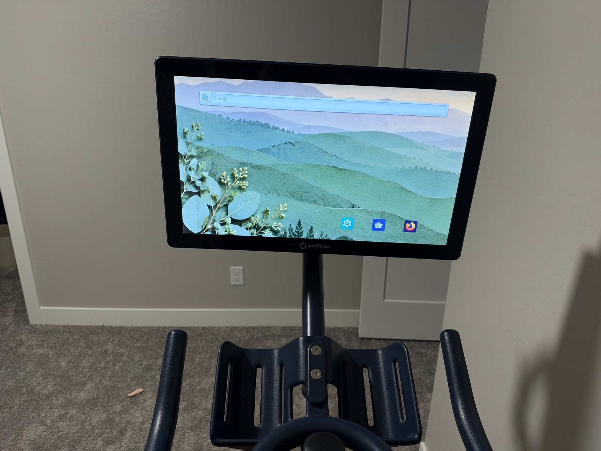

# MYX215A: remove the kiosk, keep the stock Android firmware

Tested on **one personally owned MYX215A bike tablet**: factory-mode root ADB allowed removal of the MYX device-owner configuration and use of the installed Android launcher. The successful kiosk-removal steps did not perform a bootloader unlock, ROM flash, factory reset, or creation of a guessed MediaTek security record.

> **Important context from the owner:** “I spent many hours trying different methods before this worked, and I am unsure whether any of those earlier steps contributed to the eventual success.” This guide records the final working sequence on a previously experimented-on tablet and Windows installation. It has **not** been reproduced from an untouched tablet and clean computer, so earlier device state, tools, or driver changes may have contributed. Treat this as a documented successful result, not a proven minimal set of prerequisites.

> **Tested setup: Windows 11 + GPT 6.1 Sol assistance + a verified micro-USB DATA cable.** The successful procedure was carried out on Windows 11 with GPT 6.1 Sol assisting the investigation and implementation.
>
> **Start with the cable. The owner tried THREE different micro-USB cables that did not provide a working data connection before finding one that did.** Charging, a lit screen, or a physically connected cable does not prove USB data is connected. Verify the cable can transfer data, and use the tablet's **micro-USB** port. Do this before changing drivers or concluding that a mode does not expose ADB.

## The tested tablet



The actual tablet used for this guide, after kiosk removal. Its About tablet screen reports **MYX215A**. Match that model and the documented build rather than assuming every screen sold with a MYX or MYX II bike uses the same hardware. See [more hardware photos](./docs/hardware-photos.md) for the About tablet screen and underside connections.

## What worked

- Chinese factory diagnostics mode exposed a full ADB interface.
- `adb root` produced `uid=0(root)` on the stock userdebug build.
- Backed-up configuration files were edited while the Android framework was **not running**.
- Normal boot then used the stock Android launcher and Settings.
- MYX, BODi, the MDM agent, and the updater were disabled. The persistent MDM/updater were also hidden for user 0; after reboot, none of those processes was running.
- A tiny [navigation helper](./navigation-helper/README.md) restored Back/Home/Recents automatically after a real reboot.

This removes the app kiosk restrictions. **It does not unlock the bootloader, update Android, or add Google Play certification.**

## Tested hardware/build

| Item | Observed value |
| --- | --- |
| Host operating system | Windows 11 |
| AI assistance | GPT 6.1 Sol |
| USB connection | Verified data-capable micro-USB cable |
| Tablet | MYX215A |
| SoC | Live BROM identified MT8176; firmware platform strings say MT8173 |
| Android | 8.1.0, API 27 |
| Build type | userdebug |
| Build incremental | 1642787041 |
| Kernel | 3.18.79+, built January 22, 2022 |
| Reported security patch | October 5, 2018 |
| Factory USB | `0E8D:2006`, composite storage + ADB + serial interfaces |
| ADB interface | `0E8D:2006`, interface `MI_01` on the tested build |
| Bootloader after kiosk removal | Still locked; verified boot reported green |

There is no independent replication yet. A different build may have different policies, filenames, or factory behavior. The packaged preparation script deliberately refuses unexpected owner/admin records. It must not be treated as a universal MYX unlock tool.

## Prerequisites

- Your own MYX215A and a **verified data-capable micro-USB cable**.
- A computer with [official Android platform-tools](https://developer.android.com/tools/releases/platform-tools).
- Windows PowerShell 5.1 or newer for the supplied preparation scripts. The Android commands themselves also work from other platforms, but the full walkthrough was performed on **Windows 11**.
- Enough local space for private configuration backups; optional firmware backups need much more.

Firmware dumps, personal configuration, credentials, logs, and third-party APKs are intentionally not included. The only prebuilt APK here is our small navigation helper, alongside its complete source and checksum.

## 1. Reach the Chinese factory menu

The owner's recollection of the successful factory-menu sequence is:

1. Connect the tablet to its power supply.
2. Hold **Power + Volume Up + Volume Down** together for approximately **5–10 seconds**.
3. Release **Power only**, keeping **both volume buttons** held.
4. Continue holding Volume Up + Volume Down until the **Chinese factory diagnostics menu** appears, then release them.
5. **After the Chinese menu appears**, connect the tablet's **micro-USB** port to the Windows computer using the verified **data cable**. The owner reports hearing the Windows USB connection sound at this point (if system sounds are enabled).

**Button timing is approximate and still needs a deliberate repeat test.** The owner clarified that computer micro-USB was connected **after** the Chinese menu appeared. “Connect to power” in step 1 means the tablet's power supply; do not interpret it as inserting computer USB while holding the buttons. Android settings cannot confirm the bootloader's physical button timing.

The Windows sound is a useful connection cue, not proof that the ADB driver is working. **Try `adb devices -l` before installing extra drivers.** This Windows 11 computer already had driver changes from earlier research, so whether a clean computer needs a separate driver installation is unconfirmed. Platform-tools supplies the ADB program; Windows still needs a compatible driver for the tablet's ADB interface, which may already be available or bind automatically. If Windows detects the tablet but ADB does not list it, follow [driver troubleshooting](./docs/troubleshooting.md#windows-sees-factory-usb-but-adb-is-empty).

Do not confuse this with the earlier BROM procedure: the target here is the **visible Chinese menu**, not a black screen or BROM USB ID `0E8D:0003`.

The menu included Automatic test, Manual test, Single test, Test report, Debugging test items, Clear eMMC, Version information, and Restart.

Leave it at the menu. **Do not select Clear eMMC: it erases data.** Connect the verified data cable to micro-USB. Try a direct laptop port first.

```powershell
adb devices -l
adb root
adb devices -l
adb shell id
adb shell pidof system_server
```

Expected: the tablet is listed as `device`, `id` reports `uid=0(root)`, and `pidof system_server` finds no process. ADB may briefly disconnect when restarted as root. This is **factory mode**, not recovery sideload, fastboot, or BROM. BROM `0E8D:0003` and mtkclient are not prerequisites for this successful route.

For Windows USB diagnosis, missing drivers, and an absent tablet, see [troubleshooting](./docs/troubleshooting.md).

## 2. Back up and prepare changes locally

Run from the repository root. Use the exact serial shown by your own `adb devices`; no serial is hard-coded in the scripts.

```powershell
.\scripts\Backup-Factory.ps1 -Serial YOUR_SERIAL -BackupDirectory .\private\original
.\scripts\Prepare-KioskRemoval.ps1 -BackupDirectory .\private\original -OutputDirectory .\private\prepared
```

If `adb` is not on PATH, pass `-AdbPath 'C:/path/to/platform-tools/adb.exe'` to scripts that contact the device.

The backup command only reads the tablet. Preparation only edits **local copies**. Both directories must remain private and are ignored by Git.

Review the generated XML and scripts before continuing. [What changes and why](./docs/configuration-changes.md) explains the exact scope. Do not substitute another tablet's XML or another person's backups.

**Validation status:** the underlying transformations, shell operations, and end-to-end kiosk removal were used successfully on the test tablet. These portable wrappers were written afterward and tested against synthetic fixtures; they have not been run through a second physical tablet unlock. The owner-specific original configuration is not distributed.

## 3. Apply from root factory mode

Keep the factory menu open, with root ADB and no Android framework running:

```powershell
.\scripts\Apply-Factory.ps1 -Serial YOUR_SERIAL -PreparedDirectory .\private\prepared
```

The script checks the model/mode, verifies the original files against the hashes from **your** backup, saves additional originals on the tablet, applies replacements while retaining file ownership/mode and restoring SELinux contexts, and verifies the resulting bytes. It does not automatically reboot. If a shell operation fails after edits begin, it attempts rollback and reports failure; keep the computer-side originals regardless.

```powershell
adb -s YOUR_SERIAL reboot
```

If ADB disappears after reboot, reconnect micro-USB with the screen unlocked. In Android Settings, tap **About tablet → Build number seven times**, then enable **Developer options → USB debugging** and accept any authorization prompt.

## 4. Stop the MYX apps and persistent vendor agents

From normal Android with ADB connected:

```powershell
.\scripts\Disable-MyxApps.ps1 -Serial YOUR_SERIAL
```

This uses `disable-user`, `force-stop`, and, for the two persistent system agents, `pm hide`. It retains APKs and app data. Hiding was important: merely disabling/force-stopping the persistent apps did not stop their respawning until they were hidden and the tablet rebooted.

Reboot once, reconnect USB, then verify:

```powershell
adb shell pm list packages -d
adb shell ps -A
adb shell cmd package resolve-activity --brief -a android.intent.action.MAIN -c android.intent.category.HOME
```

Expected home: `com.android.launcher3/.Launcher`. None of `com.myxfitness.app`, `com.beachbody.bod.bike`, `com.abupdate.mdm`, or `com.adups.fota` should be running.

## 5. Restore navigation buttons, including after reboot

One-time command verified on the stock build:

```powershell
adb shell am broadcast -a android.intent.action.SHOW_NAVIGATION_BAR -p com.android.systemui
```

For automatic startup restoration, verify [the artifact checksum](./artifacts/SHA256SUMS.txt), then install the supplied helper:

```powershell
Get-FileHash .\artifacts\navigation-helper-1.0.apk -Algorithm SHA256
adb install -r .\artifacts\navigation-helper-1.0.apk
adb shell am start -n org.myxunlock.navigation/.MainActivity
```

Open it once after installation. It needs only the boot-completed permission, no root and no network. After a real reboot, the helper and visible navigation bar were verified **without** manually sending the show command. Full source, rebuilding instructions, removal, and signing details are in [navigation-helper](./navigation-helper/README.md).

## Apps and limitations

- Android remains old; adding apps does not update its kernel or security patch.
- An app-only Google services/Play Store trial failed on a privileged-permission requirement and was removed. Do not assume Google-dependent apps work.
- F-Droid 2.0.2 opened on this tablet. Aurora 4.8.4 crashed rendering duplicate catalog entries; 4.7.5 opened after resetting its incompatible newer database. Aurora catalog/download reliability was mixed. These are observations, not guarantees of ongoing compatibility.
- Firefox installed during the session. Browser-based services are an option where their Android apps require Google services.
- A factory reset or vendor update can restore kiosk provisioning. Rollback likewise deliberately restores original restrictions.

## Recovery, publishing, and confirmations

- [Rollback](./docs/rollback.md): restore your own original configuration from root factory mode.
- [Publishing](./docs/publishing.md): publish only this folder; never the parent working directory.
- [Testing and limitations](./docs/testing.md): what was verified and what still needs independent confirmation.

When reporting a result, include model, Android version, build incremental, OS, USB mode and the exact working button sequence. Redact serials, MAC addresses, account details, network names, and policy contents. Never attach private backups.
