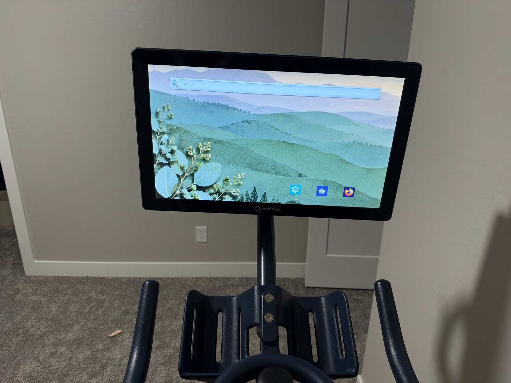
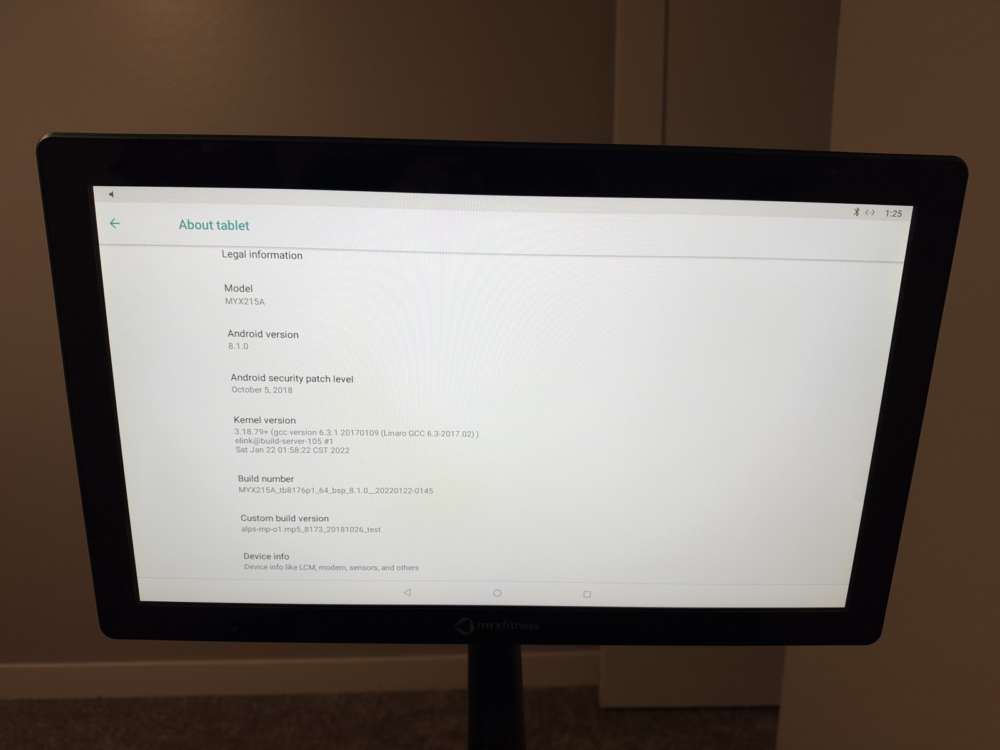
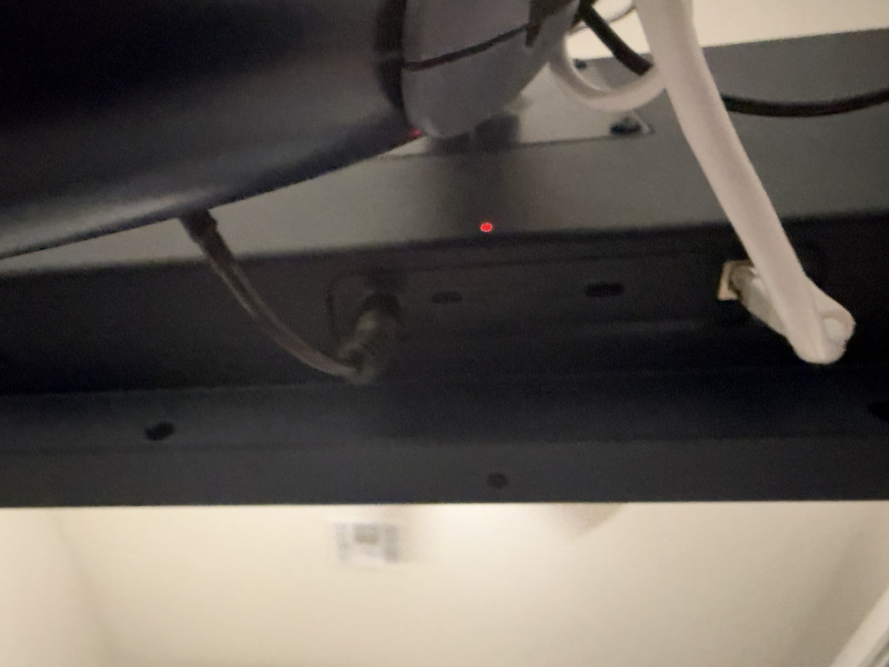

# Photos of the tested tablet

These are the owner's photos of the actual MYX215A used for the guide. They document the hardware and working result; they are not stock product photos or evidence of compatibility with other MYX tablet models.

## After kiosk removal

The original tablet and mount remain in place. The screen shows the stock Android launcher after the software kiosk restrictions were removed. The decorative wallpaper and installed apps are optional and are not part of the unlock procedure.

## Model and software identification

The displayed model is **MYX215A**, Android version **8.1.0**, reported security patch **October 5, 2018**, and kernel **3.18.79+**, with a January 2022 build date. These are more useful compatibility checks than the bike's marketing name. The photos alone do not establish whether this tablet was originally supplied with a first-generation MYX or a MYX II bike.

## Underside connections

This photo provides an orientation reference for the underside connector area. It is not sharp enough to identify every connector or button reliably. The successful computer connection in this guide used **micro-USB with a verified data-capable cable**, not the USB-C connector.

## Publication notes

- Only these three photos are included. Rear-label photos containing the device serial number were left out of the public repository.
- The iPhone HEIC originals remain outside this repository. Published copies are JPEG, scaled to a maximum dimension of 1600 pixels, with photo metadata removed.
- No hardware details were generated, retouched, or reconstructed. Conversion, resizing, and metadata removal were the only processing applied to these published photos.
- Owner-supplied photos are included under this repository's [MIT License](../LICENSE).
